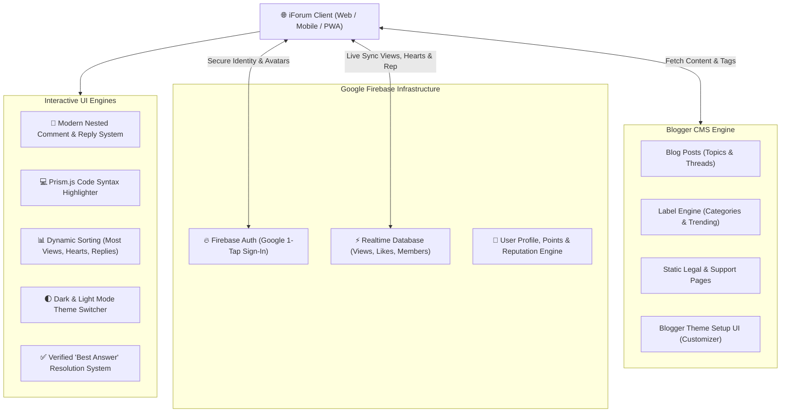

# iForum — Modern Community & Discussion Forum Platform for Blogger

  

  
  
  
  
  

  
  

> **iForum** transforms your standard Blogger website into a lightning-fast, interactive, real-time discussion forum and tech community hub. Powered by **Google Firebase Realtime Database & Authentication**, it overcomes Blogger's static limits to offer dynamic post views, real-time heart reactions, best-answer badges, nested replies, user profile reputation cards, and code block formatting — zero paid database hosting required.

---

## 📑 Complete Documentation Suite

| Document | Audience | Highlights |
|---|---|---|
| [**Interactive Docs Portal (docs/index.html)**](docs/index.html) | Everyone | Live web-based documentation dashboard with search, interactive guides, and feature walkthroughs. |
| [**INSTALLATION.md**](docs/setup/installation.md) | Site Owners & Beginners | 4-step installation in Blogger (`Theme → Restore`), layout setup, and initial configuration. |
| [**FIREBASE_SETUP.md**](docs/setup/firebase-setup.md) | Administrators | Step-by-step setup for Firebase Realtime Database rules, Google Authentication, and authorized domains. |
| [**LICENSE_SYSTEM.md**](docs/setup/license-activation.md) | Buyers & Webmasters | Standalone HTML DJB2 Hex generator usage, Blogger Theme Setup camouflage, and activation steps. |
| [**COMMENTS_SYSTEM.md**](docs/features/comments-and-replies.md) | Developers & Customizers | Full structure of the modern nested comment system, sorting engine, and action triggers. |
| [**COMMUNITY_AND_GAMIFICATION.md**](docs/features/gamification-and-badges.md) | Community Managers | Role badges (Admin, Member, Newbie), reputation score tracking, and leaderboards. |
| [**PAGES_AND_SETUP.md**](docs/setup/pages-setup.md) | Webmasters | Ready-to-use template HTML for Guidelines, Help Center, Privacy Policy, and Terms of Service. |
| [**TROUBLESHOOTING_FAQ.md**](docs/setup/troubleshooting-faq.md) | Support & DevOps | Solutions for Firebase CORS, 0 view counts, Google Auth domain popup issues, and layout editing. |

---

## 🚀 Core Architectural Highlights

---

## 🌟 Feature Breakdown & Functions

### 1. Real-Time Interaction (Firebase RTDB)
- **Live Post Views & Hearts**: Automatic debounce counter syncing post views and heart reactions without refreshing.
- **Dynamic Leaderboards & Sorting**: Sort forum topics by **Most Recent**, **Oldest**, **Most Hearts**, **Most Replies**, and **Most Views**.
- **Real-Time Member Stats**: Live member pulse widget displaying total threads, replies, and online status.

### 2. Modern Discussion & Comment Section
- **Nested Replies**: Two-tier discussion threads with clean indentations and responsive mobile collapse.
- **Rich Text & Emoji Controls**: Fast formatting buttons for bold, italic, underline, emojis, and member mentions (`@user`).
- **Best Answer System**: Topic authors and moderators can pin solutions with the distinct green "Best Answer" badge.
- **Sorting Dropdown**: Comment sorting by *Most Recent* and *Oldest First*.

### 3. Developer & Tech Community Ready
- **Prism.js Syntax Highlighting**: Clean, readable syntax highlighting for HTML, CSS, JavaScript, Python, JSON, and Bash.
- **Copy Code Buttons**: 1-click clipboard copy on all code blocks with feedback toast animation.

### 4. Domain-Locked Licensing (DJB2)
- **Anti-Theft Protection**: Hardened DJB2 32-bit hashing algorithm generating 6-digit hex activation keys.
- **Blogger Theme Setup Integration**: Buyers configure their key seamlessly via `Theme → Customize → Advanced → Theme Setup` with discreet camouflage against unauthorized code tampering.

---

## 🛠️ Quick Installation Guide

1. **Upload Theme to Blogger**:
   - In Blogger Dashboard, navigate to **Theme → Edit HTML** or click the dropdown arrow next to **Customize** and select **Restore**.
   - Select the `iForum Premium.xml` file.
2. **Setup Firebase Project**:
   - Create a free project at [Firebase Console](https://console.firebase.google.com/).
   - Enable **Realtime Database** (Test Mode or Custom Rules) and **Google Authentication**.
   - Add your blog domain (e.g., `yourforum.blogspot.com`) to Firebase **Authorized Domains**.
3. **Insert Firebase Config**:
   - Scroll to the bottom of the theme file just above `</body>` and paste your `apiKey`, `authDomain`, `databaseURL`, and `projectId`.
4. **Activate Theme License**:
   - Use the standalone Key Generator tool with your domain name.
   - Enter your 6-digit hex key in Blogger's theme customization panel.

---

## 💬 Support & Community

Need assistance or have customization questions?
- **Telegram Support**: [@ayengcoding](https://t.me/ayengcoding)
- **Official Discussion Group**: [ABEFILM Group](https://t.me/abefilmgroup)

---

## 📄 License
iForum is commercial theme software protected by domain-locked licensing. Unauthorized redistribution or reselling is strictly prohibited.
