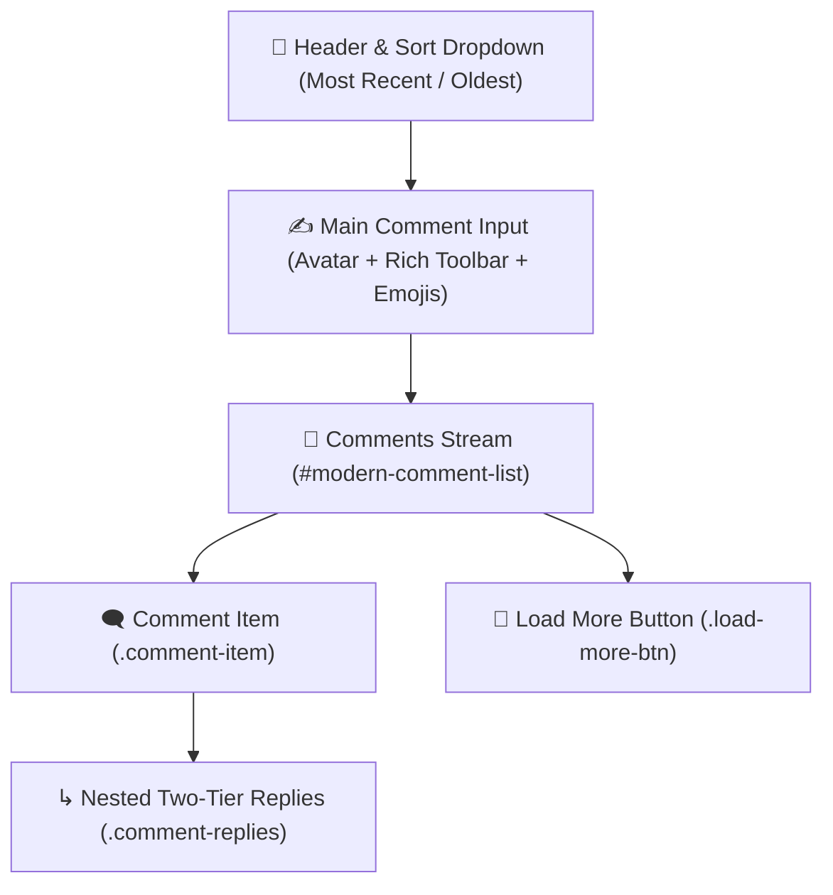

# Modern Comments & Nested Replies Engine

The iForum comment engine is built to match the UX of top modern community platforms like Reddit, Discord, and StackOverflow.

---

## 🎨 Architecture & Components

---

## 🧩 Key Subsystems

### 1. Two-Tier Nested Replies
- Top-level responses appear as root cards.
- Clicking **Reply** opens an in-place micro-composer directly beneath the target comment.
- Replies render inside `.comment-replies` with an intentional 48px left indentation line and auto-collapse behavior on small smartphone screens.

### 2. Verified "Best Answer" Resolution
- Topic authors and administrators see a **Mark as Best Answer** button.
- Once selected:
  - The comment is automatically styled with a green highlight border and a distinctive floating `BEST ANSWER` ribbon.
  - The parent topic is marked as resolved in forum listing cards.

### 3. Rich Text & Emoji Controls
- In-place quick formatting buttons:
  - `<b>` Bold
  - `<i>` Italic
  - `<u>` Underline
  - `@` User Mention
- Built-in emoji drawer allowing users to express reactions directly in text.

### 4. Dynamic Sorting
- **Most Recent**: Reverse chronological order for live fast-paced threads.
- **Oldest First**: Chronological reading mode for tutorials, problem-solving, or timeline debugging.
