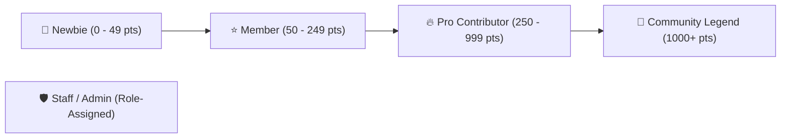

# Gamification, Badges & User Profiles

iForum turns passive readers into active contributors by introducing a full gamification layer stored and synced via Firebase Realtime Database.

---

## 🏆 Reputation & Points System

Users earn points dynamically as they participate in the community:

| Activity | Points Awarded | Database Node |
|---|---|---|
| **Starting a New Discussion** | +10 Points | `/users/{uid}/points` |
| **Writing a Useful Reply** | +5 Points | `/users/{uid}/points` |
| **Receiving a Heart / Like** | +2 Points | `/users/{uid}/points` |
| **Marked as "Best Answer"** | +25 Points | `/users/{uid}/points` |

---

## 🎖️ User Roles & Badge Hierarchy

### 1. Visual Badges
- **Admin**: Distinguishable red accent badge (`.badge-admin`) with custom star icon.
- **Member**: Sleek translucent badge with user status.
- **Icon-Only Badges**: Minimalist badge mode for compact comment user rows, displaying crisp SVG icons without excessive visual noise.

---

## 👤 User Profile Hover Cards

Hovering or clicking on an author's avatar renders the **Profile Hover Card**:
- Displays high-resolution avatar and dynamic banner.
- Displays author's total topic count, total replies count, and current reputation rank.
- Quick link to view all discussions authored by this member.
